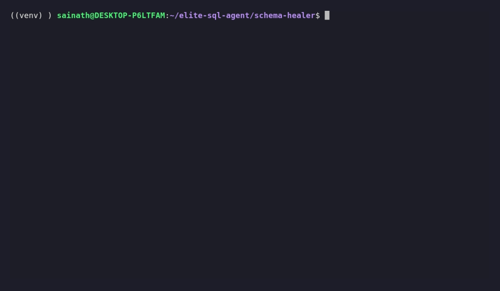

# schema-healer: A Deterministic LLM-to-SQL Engine

An agentic architecture that bounds LLM non-determinism using AST hashing, pre-flight query costing, and a self-healing database execution loop.

Most "Agentic SQL" projects are thin wrappers that pipe probabilistic LLM outputs directly into a database. This project treats the LLM as an untrusted client. It wraps the generation step in a deterministic Python orchestration layer (built on Pydantic AI) to guarantee execution safety, prevent infinite retry loops, and autonomously self-correct syntax or schema hallucinations without crashing.

## The Proof of Work: Autonomous Self-Healing



When the LLM hallucinates a non-existent column (e.g., `created_at`), a standard application throws a `500 Internal Server Error`. **schema-healer** catches the raw `sqlite3.OperationalError`, feeds the stack trace back to the agent as an observation, and successfully patches the query within a bounded execution circuit.

```text
[Engine] Intercepting Query: SELECT u.email, SUM(s.amount) AS total_spending 
FROM enterprise_users u JOIN spending_logs s ON u.user_id = s.user_id 
GROUP BY u.email ORDER BY MIN(u.created_at) ASC;
[Engine] DATABASE ERROR: no such column: u.created_at

[Engine] Intercepting Query: SELECT u.email, SUM(s.amount) AS total_spending 
FROM enterprise_users u JOIN spending_logs s ON u.user_id = s.user_id 
GROUP BY u.email;
[Engine] Success: [('alice@test.com', 500.0), ('bob@internal.com', 9000.0)]

FINAL ANSWER: The available data does not contain the account creation date. The total spending calculated for each user based on email is: alice@test.com: $500.00, bob@internal.com: $9000.00
```

## Core Architecture & Defenses

*   **The Context Router (Decoupled Memory):** Prevents multi-turn context collapse. A routing agent intercepts conversational input and distills it into a context-free, deterministic request before it ever reaches the heavy Text-to-SQL generator.
*   **AST Hashing (Loop Prevention):** Parses generated SQL into Abstract Syntax Trees using `sqlglot`. If the agent attempts to submit a functionally identical query that previously failed (ignoring whitespace/alias changes), the engine blocks it and injects a deterministic loop-break prompt.
*   **The Execution Bodyguard (Pre-flight Costing):** Intercepts queries with `EXPLAIN QUERY PLAN` before execution. If the engine detects an unindexed full table scan (e.g., `SCAN TABLE`), it aborts execution to protect warehouse compute resources.
*   **The Circuit Breaker:** The LLM does not control its own retry loop. The system is governed by a hard-coded Python state machine with a strict `max_iterations` ceiling to mathematically guarantee termination.

## System Design

```text
src/
├── state.py       # Manages schema RAG metadata and AST hash memory
├── agents.py      # Pydantic AI Context Router and SQL Generator definitions
├── tools.py       # Defensive Execution Bodyguard and Schema Search RAG
└── engine.py      # The Circuit Breaker and main execution loop
```

## Getting Started

**1. Clone the repository**
```bash
git clone https://github.com/sainathmanda7/schema-healer.git
cd schema-healer
```

**2. Setup Environment**
```bash
python3 -m venv venv
source venv/bin/activate
pip install -r requirements.txt
```

**3. Configure API Keys**
```bash
echo 'OPENROUTER_API_KEY=sk-or-v1-...' > .env
```
*(Note: To suppress the Pydantic AI logging banner, add `PYDANTIC_AI_NO_BANNER=1` to your `.env`)*

**4. Initialize the Mock Data Warehouse**
```bash
python3 setup_db.py
```

**5. Run the Engine**
```bash
python3 -m src.engine
```